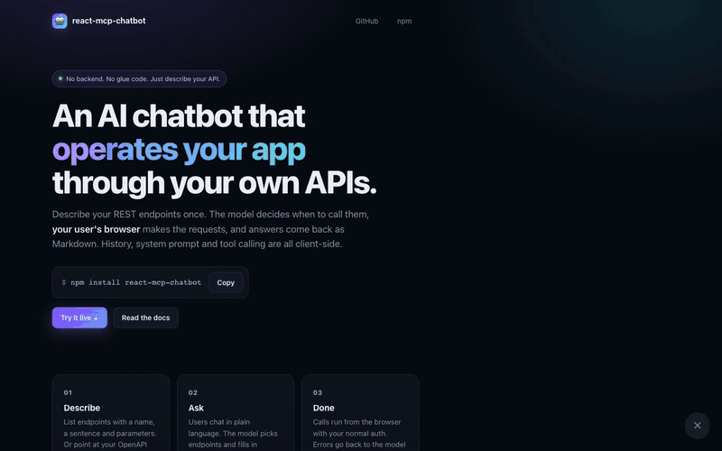

<p align="center">
  <a href="https://www.npmjs.com/package/react-mcp-chatbot">
    
  </a>
  <a href="https://www.npmjs.com/package/react-mcp-chatbot">
    
  </a>
  <a href="https://github.com/TigranZakharyan/react-mcp-chatbot/actions/workflows/ci.yml">
    
  </a>
  <a href="https://bundlephobia.com/package/react-mcp-chatbot">
    
  </a>
  
  <a href="https://github.com/TigranZakharyan/react-mcp-chatbot/blob/main/LICENSE">
    
  </a>
  <a href="https://github.com/TigranZakharyan/react-mcp-chatbot/stargazers">
    
  </a>
</p>

<h1 align="center">🤖 React MCP Chatbot</h1>

<p align="center">
  <strong>An AI chatbot that talks to your backend APIs – with no backend of its own</strong>
</p>

<p align="center">
  Describe your existing REST endpoints. The model decides when to call them, the browser executes the calls, and the answer comes back as Markdown. History, system prompt and tool calling all live client-side.
</p>

<p align="center">
  <a href="https://tigranzakharyan.github.io/react-mcp-chatbot/"><b>▶ Live demo</b></a> ·
  <a href="#quick-start">Quick start</a> ·
  <a href="#faq">FAQ</a> ·
  <a href="./CHANGELOG.md">Changelog</a>
</p>

<hr />

## Demo

<p align="center">
  
</p>

Recorded with a local `llama3.1` via Ollama (no API key, no scripted replies). The assistant lists the processing orders, asks permission before the `POST`, cancels order 1002, and the table on the page updates. Its only knowledge of the backend is the three endpoint descriptions in [`demo/src/main.tsx`](./demo/src/main.tsx).

**[Try it live](https://tigranzakharyan.github.io/react-mcp-chatbot/)** – it opens in **Demo mode** (a simulated, rule-based model: no key, no cost, no AI), or switch to a real provider with your own API key (it stays in your browser tab). Ollama and the free tiers of providers like Groq and Gemini work too. You can also run it locally. The demo ships an in-browser fake orders API, so no backend is needed:

```bash
git clone https://github.com/TigranZakharyan/react-mcp-chatbot
cd react-mcp-chatbot/demo
npm install
npm run dev
```

Choose a provider, paste a key (or pick `ollama` with a tool-capable model running locally) and try *"Which orders are still processing?"* or *"Cancel order 1002"*.

## Why this exists

Adding "chat with our app" to a product usually means building a chatbot backend: a proxy for the LLM, a tool-calling loop, session storage, and glue that re-implements the endpoints you already have. **react-mcp-chatbot removes that layer.**

| Without | With react-mcp-chatbot |
| --- | --- |
| A server that holds the conversation and runs the tool loop | The loop, history and system prompt run in the browser |
| Re-wrapping every REST endpoint as an LLM tool | Describe the endpoint once (or import your OpenAPI spec) |
| Provider-specific code for each LLM vendor | One config, native function calling for 10+ providers |
| Backend auth plumbing for the bot | Requests use the signed-in user's own credentials, so existing permissions apply |

**Good fit:** admin panels, internal tools, SaaS dashboards, prototypes, local-first apps. **Not a fit:** anything that needs the LLM key to stay secret without a proxy – see [client-side caveats](#things-to-know-about-running-fully-client-side).

## FAQ

**How do I add an AI chatbot to my React app without writing a backend?**
Install the package, render `<MCPAgent />` with a provider, a model and your endpoint list. See [Quick start](#quick-start).

**How can an LLM call my existing REST API from the browser?**
Each endpoint you describe (or each OpenAPI operation) is sent to the model as a function-calling tool. The model returns which one to call; the package performs the `fetch` and feeds the result back.

**Does it work with a local model?**
Yes – use `provider="ollama"` with a tool-capable model such as `llama3.1`. No API key needed.

**How do I stop the bot from making destructive calls?**
Use `beforeToolCall` to confirm or block, `include`/`exclude` to limit which OpenAPI operations are exposed, and only describe endpoints you are happy for the user to trigger.

**Does it support CommonJS and ESM, with TypeScript types?**
Both, and types are bundled.

## How it compares

Most chat toolkits assume a server route that runs the model and tools. This one is deliberately the opposite. A rough guide (check each project's docs – they evolve):

| | react-mcp-chatbot | Server-centric chat SDKs (e.g. Vercel AI SDK `useChat`, CopilotKit runtime) |
| --- | --- | --- |
| Where the tool-calling loop runs | Browser | Typically your server |
| Needs a chat backend / API route | No | Usually yes |
| Tools defined from | REST endpoint descriptions or an OpenAPI spec, called with the user's own session | Server-side functions you write |
| LLM key exposure | Visible to the client unless you add a proxy | Kept on the server |
| Best for | Dashboards, internal tools, prototypes, local-first apps | Public products where the key and tools must stay private |

Pick the server-centric route when secrets or business logic must not reach the browser; pick this when your existing API already enforces permissions and you just want a chat front-end for it.

## Install

```bash
npm install react-mcp-chatbot
```

## Quick start

```tsx
import { MCPAgent } from "react-mcp-chatbot";

<MCPAgent
  provider="openai"            // openai | anthropic | gemini | deepseek | groq | ollama | openrouter | mistral | xai | together | openai-compatible
  model="gpt-4o-mini"
  apiKey={...}
  systemPrompt="You are the support assistant for Acme. Be concise."
  api={{
    baseURL: "https://api.acme.com",
    headers: () => ({ Authorization: `Bearer ${getToken()}` }),
    endpoints: [
      {
        name: "get_order",
        description: "Look up an order by id",
        path: "/orders/{id}",
        parameters: { id: { type: "string", description: "Order id" } },
      },
      {
        name: "cancel_order",
        description: "Cancel an order",
        method: "POST",
        path: "/orders/{id}/cancel",
        parameters: {
          id: { type: "string" },
          reason: { type: "string", optional: true },
        },
      },
    ],
  }}
/>
```

That is the whole integration. The model gets native function-calling schemas generated from your descriptions, picks endpoints, fills arguments, chains several calls if needed, reads the responses and answers. Tool errors (HTTP 4xx/5xx, missing arguments) are returned to the model so it can retry or explain.

Parameters go to `path` if `{name}` is in the path, otherwise `query` (GET/DELETE) or JSON `body` (POST/PUT/PATCH). Override per parameter with `in: "path" | "query" | "body" | "header"`.

### Already have an OpenAPI / Swagger spec?

```tsx
<MCPAgent
  provider="gemini" model="gemini-2.5-flash" apiKey={...}
  api={{
    baseURL: "https://api.acme.com",
    openapi: "https://api.acme.com/openapi.json", // URL or object
    exclude: ["deleteUser"],                       // or include: [...]
  }}
/>
```

Every operation becomes a tool (`operationId` is the tool name, `summary`/`description` the description).

### Custom JS tools

Still supported, and can be mixed with `api`:

```tsx
tools={[{
  name: "get_cart",
  description: "Current contents of the user's cart",
  parameters: {},
  call: async () => store.getState().cart,
}]}
```

## History, system prompt, clearing

- **History** is kept in the browser and sent with every request (last `maxHistoryMessages`, default 40, cut at a turn boundary so tool exchanges are never split).
- **Persistence**: `persist` saves it to `localStorage` (`persist` or `persist="my-key"`). Off by default – on shared computers a saved chat can expose data returned by your API.
- **System prompt**: `systemPrompt="..."` replaces the default.
- **Clear**: built-in *Clear* button in the header (`showClearButton={false}` to hide), or via ref:

```tsx
const ref = useRef<MCPAgentHandle>(null);
<MCPAgent ref={ref} ... />
ref.current?.clear();
```

## Customization

Everything about the look is a prop – no CSS overrides needed.

```tsx
<MCPAgent
  theme="auto"                      // "dark" (default) | "light" | "auto" (follows the OS)
  primaryColor="#0ea5e9"
  colors={{ aiBubble: "#f1f5f9", bg: "#ffffff" }}   // override any individual colour
  title="Acme Support"
  subtitle="Typically replies in a minute"          // null hides it
  avatar="/logo.png"                // emoji, image URL or a React node
  launcherIcon={<MyIcon />}
  welcomeTitle="Need a hand?"
  welcomeMessage="Ask about your orders."
  suggestions={["Where is my order?", "Cancel order 1002"]}
  fontFamily="Inter, sans-serif"
  borderRadius={12}
  align="left" bottomOffset={16} sideOffset={16}
  markdownComponents={{ a: (p) => <a {...p} target="_blank" rel="noreferrer" /> }}
/>
```

**Use your own button** – hide the launcher and control the window:

```tsx
const ref = useRef<MCPAgentHandle>(null);

<button onClick={() => ref.current?.toggle()}>Ask AI</button>
<MCPAgent ref={ref} showLauncher={false} {...config} />

// or fully controlled
<MCPAgent open={open} onOpenChange={setOpen} />
```

| Group | Props |
| --- | --- |
| Text | `title`, `subtitle`, `placeholder`, `buttonLabel`, `welcomeTitle`, `welcomeMessage`, `suggestions` |
| Colours | `theme`, `primaryColor`, `colors` |
| Shape & type | `width`, `height`, `borderRadius`, `fontFamily`, `className`, `style` |
| Icons | `avatar`, `launcherIcon`, `welcomeIcon` |
| Position | `align`, `bottomOffset`, `sideOffset`, `zIndex` |
| Behaviour | `defaultOpen`, `open`, `onOpenChange`, `showLauncher`, `showClearButton` |
| Content | `markdownComponents` |

`colors` accepts: `bg`, `surface`, `surfaceHover`, `border`, `text`, `textMuted`, `accent`, `accentHover`, `userBubble`, `userBubbleText`, `aiBubble`, `aiBubbleText`, `inputBg`, `inputBorder`, `inputFocus`, `scrollbarThumb`, `shadow`, `codeBg`, `codeText`, `preBg`, `tableHeadBg`. Try it live in the [demo](https://tigranzakharyan.github.io/react-mcp-chatbot/).

## Headless usage

```tsx
import { useChat } from "react-mcp-chatbot";

const { messages, send, clear, stop, loading, status } = useChat({ provider, model, apiKey, api });
```

`ChatEngine` (the same core, no React) is exported too.

## Options

| Prop | Description |
| --- | --- |
| `provider`, `model` | Required. |
| `apiKey` | Required for hosted providers. |
| `providerURL` | Override base URL (your proxy, Azure, vLLM, LM Studio…). Required for `openai-compatible`; default `http://localhost:11434` for `ollama`. |
| `systemPrompt` | Instructions for the assistant. |
| `api` | `{ baseURL, headers?, credentials?, endpoints?, openapi?, include?, exclude?, maxResponseChars? }` |
| `tools` | Custom tools. |
| `persist` | `boolean \| string` – save history to localStorage. |
| `maxHistoryMessages` | Default 40. |
| `maxToolRounds` | Max tool round-trips per message. Default 8. |
| `maxToolResultChars` | Default 8000. Long API responses are truncated before going to the model. |
| `beforeToolCall` | `({name, args, method}) => boolean \| Promise<boolean>` – return `false` to block. Use it to confirm writes. |
| `onToolCall`, `onError` | Observability hooks. |
| `temperature`, `headers` | Passed to the provider. |
| UI | See [Customization](#customization) |

## Things to know about running fully client-side

- **API keys are visible to your users.** For anything public, point `providerURL` at a thin proxy that adds the key (or use per-user keys / a local model such as Ollama). The proxy needs no chatbot logic – it just forwards.
- **The assistant acts with the user's own credentials.** Tool calls are plain `fetch` calls from the browser, so your backend's normal auth, CORS and permissions apply. Expose only the endpoints you want the model to reach, and use `beforeToolCall` to confirm mutating calls.
- **CORS**: your backend must allow the page's origin; so must the LLM provider (OpenAI, Anthropic, Gemini, Groq work from browsers; for Ollama set `OLLAMA_ORIGINS`).
- Models must support tool calling (e.g. Ollama `llama3.1`+, not every local model does).

## Contributing

Issues and PRs are welcome. To work on the package:

```bash
git clone https://github.com/TigranZakharyan/react-mcp-chatbot
cd react-mcp-chatbot && npm install
npm test          # unit tests (mocked providers, no keys needed)
cd demo && npm install && npm run dev
```

Ideas that would make good first contributions: response streaming, a Vue / vanilla-JS wrapper around `ChatEngine`, a per-endpoint `confirm` flag, markdown theming props, and more provider tests. See the [CHANGELOG](./CHANGELOG.md) for what changed between versions.

## License

MIT © [Tigran Zakharyan](https://github.com/TigranZakharyan)
